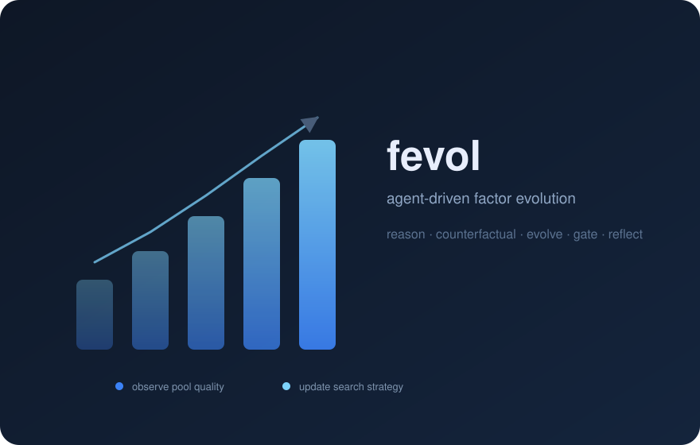
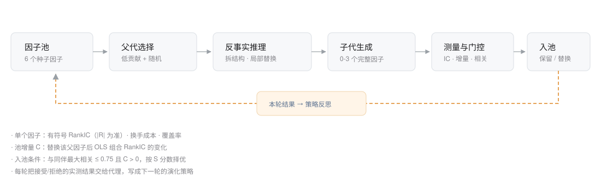

<p align="center">
  
</p>

<h3 align="center">让因子池在搜索中自我改进</h3>
<p align="center"><i>An LLM agent that evolves factors — and learns how to search better.</i></p>

`fevol` 把因子挖掘写成一个可观察的闭环：**推理 → 反事实测量 → 演化 → 门控入池 → 策略反思**。
代理在每一轮读到自己上一轮的真实评估结果（哪些编辑提升了 |RankIC|、哪些被相关性或池增量门槛拒绝），
并据此更新下一轮的搜索策略，而不是一次性生成一堆公式。

## 管线



1. **父代选择**：用删除一个因子后池效用的下降量衡量贡献，一半取贡献最低的因子做修补，一半随机探索。
2. **反事实推理**：代理把父因子拆成可编辑子树，给出局部替换及其"假设 + 预期影响"。
3. **实测打标**：把每个替换真正算一遍，得到 `delta = |R(反事实)| - |R(父)|`、替换进池后的增量 `C` 与信号距离。
4. **子代生成**：代理结合实测证据、链条历史与当前策略，生成 0-3 个完整新因子（允许返回空，表示父因子保留）。
5. **门控入池**：候选须满足与同伴最大相关 ≤ 0.75、池增量 `C > 0`，再按 `S = |R| + 0.5C + 0.3(1-cost)` 与父因子比较。
6. **策略反思**：把本轮接受/拒绝的结果写回"演化策略"，作为下一轮提示词的先验。

单个因子的度量：

| 指标 | 含义 |
| --- | --- |
| `R` | 逐日横截面 RankIC 均值（有符号）；质量看 `|R|`，不做自动翻转 |
| `cost` | 由信号相邻日秩相关得到的换手代理，越低越好 |
| `C` | 把候选替换进池后，池内带符号 OLS 组合的 RankIC 变化 |
| 覆盖 | 有效截面占比，缺失按中性处理 |

## 快速开始

```bash
pip install -r requirements.txt
export DEEPSEEK_API_KEY=sk-...      # Windows: $env:DEEPSEEK_API_KEY="sk-..."

python -m fevol evolve --data ./data/feathers --out runs/demo --rounds 10
python -m fevol report --run runs/demo --data ./data/feathers
```

数据为宽表 feather，每张表含 `date` 列与股票列：`open high low close amt num_trades cumadj`。
`--start/--end/--label-days/--capacity/--parents` 均可调；初始因子可用 `--seeds seeds.json` 覆盖。

## 结果

在 2025-01 至 2026-10 的 5451 只 A 股、431 个交易日、5 日前瞻收益上，从 6 个经典种子出发演化 10 轮：

| 指标 | 种子池 | 演化后 | 变化 |
| --- | ---: | ---: | ---: |
| 池效用（OLS 组合 RankIC） | 0.0727 | **0.1046** | +44% |
| 平均 \|RankIC\| | 0.0351 | **0.0601** | +71% |
| 最优 \|RankIC\| | 0.0573 | **0.0896** | +56% |
| 子代接受率 | — | 6 / 26 | 23% |


每次被接受的替换都提升了单个因子质量，且都通过了相关性门槛：


最终池的组成（表达式由代理改写，例如给成交额差分子加秩变换、把分母换成平滑后的去均值波动）：


组合信号的样本内 RankIC 稳定性（均值 0.0985，20 日均值多数时间站上 0）：


代理自己写下的策略也在逐步收敛（节选）：

> 第 3 轮：对分子做 TsRank 秩变换显著提升 |RankIC|（0.027→0.047）且相关性低，应复用；换分母为 TsSkew 或成交额波动均弱，避免仅改分母。
>
> 第 5 轮：分母用成交额波动虽提 |IC|，但 credit≈0 且 max_corr 达 0.75-0.81，撞相关性门槛；下轮优先保留分子秩/去均值，换用低相关分母。
>
> 第 9 轮：分母去均值平滑替换成功入池，credit 微正、相关性 0.44 安全；被拒的 TsMaxDiff 分母 credit 为负。

## 目录

```
fevol/
  data.py        宽表读取、复权、前瞻收益与可交易域
  expression.py  表达式校验、数值求值、子树定位与替换
  metrics.py     RankIC、换手代理、池内 OLS 组合
  pool.py        测量缓存、候选打分、父代替换
  agent.py       LLM 客户端与推理 / 演化 / 反思
  runner.py      演化主循环与日志
  report.py      图表与 Markdown 报告
runs/demo/       本次演示的日志、state.json 与图表
```

## 说明

- 评估是样本内的（含 OLS 组合的样本内拟合），用于比较搜索效率，不等价于样本外收益；实盘前仍需滚动窗口验证。
- 因子只做多空排序口径，未接入撮合与费用；`cost` 是换手代理，不是真实成本。
- 代理输出经过结构校验与重试；单因子失败只跳过该父代，不中断整轮。
