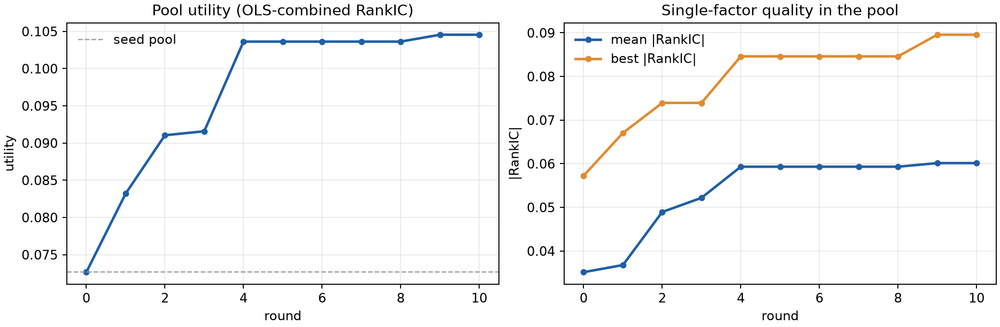
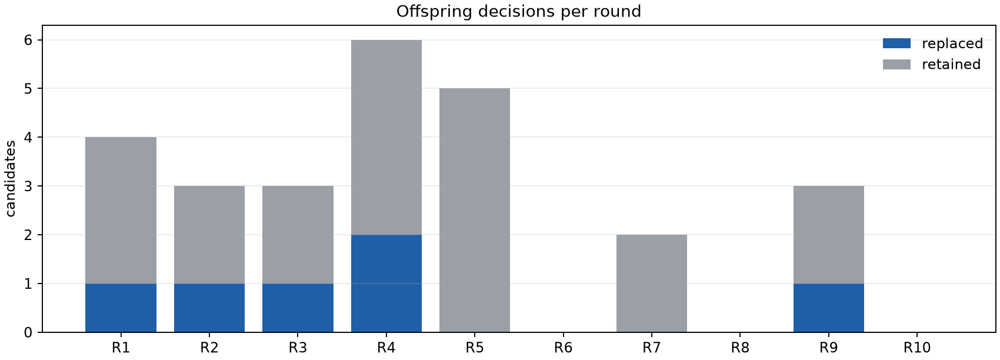
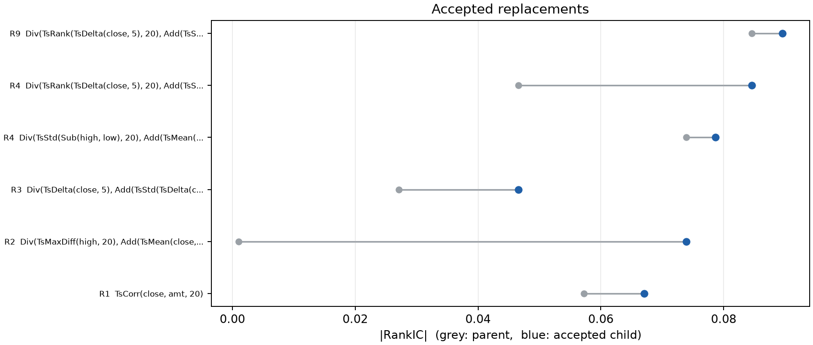
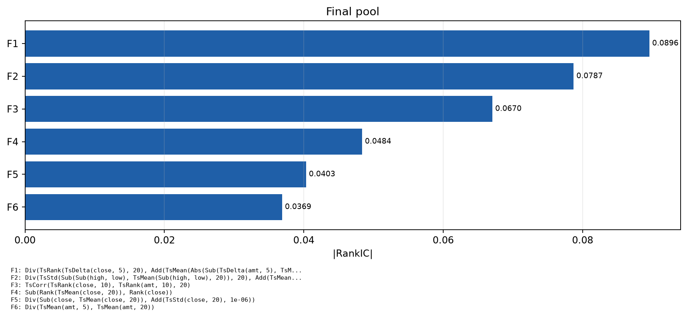
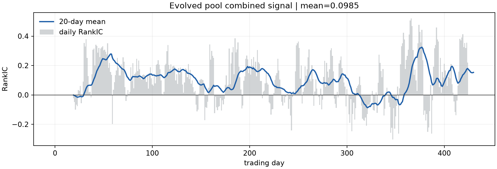

# 因子演化报告

## 池质量
| 轮次 | 池效用 | 平均 \|RankIC\| | 最优 \|RankIC\| | 子代 | 接受 | 耗时(s) |
| --- | ---: | ---: | ---: | ---: | ---: | ---: |
| 0 | 0.0727 | 0.0351 | 0.0573 | - | - | - |
| 1 | 0.0832 | 0.0368 | 0.0670 | 4 | 1 | 51.1 |
| 2 | 0.0911 | 0.0489 | 0.0739 | 3 | 1 | 36.7 |
| 3 | 0.0916 | 0.0522 | 0.0739 | 3 | 1 | 39.0 |
| 4 | 0.1036 | 0.0593 | 0.0846 | 6 | 2 | 73.1 |
| 5 | 0.1036 | 0.0593 | 0.0846 | 5 | 0 | 69.2 |
| 6 | 0.1036 | 0.0593 | 0.0846 | 0 | 0 | 7.6 |
| 7 | 0.1036 | 0.0593 | 0.0846 | 2 | 0 | 39.7 |
| 8 | 0.1036 | 0.0593 | 0.0846 | 0 | 0 | 6.8 |
| 9 | 0.1046 | 0.0601 | 0.0896 | 3 | 1 | 39.0 |
| 10 | 0.1046 | 0.0601 | 0.0896 | 0 | 0 | 6.7 |

## 最终因子池
| 因子 | 表达式 | RankIC | cost | 节点 |
| --- | --- | ---: | ---: | ---: |
| F1 | `Div(Sub(close, TsMean(close, 20)), Add(TsStd(close, 20), 1e-06))` | -0.0403 | 0.0738 | 24 |
| F2 | `Div(TsMean(amt, 5), TsMean(amt, 20))` | -0.0369 | 0.0333 | 15 |
| F3 | `Sub(Rank(TsMean(close, 20)), Rank(close))` | +0.0484 | 0.0524 | 17 |
| F4 | `Div(TsRank(TsDelta(close, 5), 20), Add(TsMean(Abs(Sub(TsDelta(amt, 5), TsMean(TsDelta(amt, 5), 10))), 10), 1e-06))` | +0.0896 | 0.0501 | 43 |
| F5 | `TsCorr(TsRank(close, 10), TsRank(amt, 10), 20)` | -0.0670 | 0.0158 | 16 |
| F6 | `Div(TsStd(Sub(Sub(high, low), TsMean(Sub(high, low), 20)), 20), Add(TsMean(close, 20), 1e-06))` | -0.0787 | 0.0114 | 38 |

## 演化策略更新
- 第 1 轮：优先对相关性类因子先做横截面秩变换再求滚动相关，并适度放大窗口（秩10/窗口20优于5/10），可显著提升|RankIC|且降相关；避免仅改分母/平滑的结构微调，易触发高相关(0.88)或零池增量被拒；下轮继续小窗反转与成交额异动，先秩标准化再组合。
- 第 2 轮：高低价差波动率除以均价显著提升|RankIC|且相关性低，可复用；同结构换分母或换均值被池增量门槛拒绝，应避免仅改分母。保留秩变换后滚动相关与放大窗口结论；下轮优先波动率结构+小窗反转、成交额异动，先秩标准化再组合。
- 第 3 轮：对分子做TsRank秩变换显著提升|RankIC|(0.027→0.047)且相关性低，应复用；换分母为TsSkew或成交额波动均弱，避免仅改分母。下轮优先：分子秩标准化+保留原分母结构，小窗反转、成交额异动；避免复杂分母替换。
- 第 4 轮：分子去均值(TsStd(Sub(x,TsMean(x,20))))提升|IC|且credit正，可复用；分母换成交额波动(TsStd(TsDelta(amt,5)))由0.047跃至0.085，成交额异动是强方向。分母换volume、缩窗至10均被credit门槛拒。下轮优先：保留分子秩/去均值结构，分母改用成交额类波动或异动，慎改窗口。
- 第 5 轮：本轮5个后代全被拒：分母用成交额波动虽提|IC|，但credit≈0且max_corr达0.75-0.81，撞相关性门槛；分子去均值+分母成交额波动结构仍有效但需降相关。下轮优先保留分子秩/去均值，换用低相关分母（如成交笔数、价量比）并控窗口；避免重复成交额波动分母。
- 第 6 轮：本轮无后代产生，旧结论仍有效：分子秩/去均值+成交额波动分母提|IC|但相关0.75-0.81被拒。下轮优先用成交笔数、价量比等低相关分母并控窗口，保留去均值结构；避免重复成交额波动分母，控max_corr<0.7、争取credit>0。
- 第 7 轮：成交笔数、价量比分母显著降|IC|且credit为负，被池增量门槛拒；低相关但无增益。下轮应放弃分母替换，改在分子端做窗口缩放或秩变换，保留去均值结构，控max_corr<0.7并务必使credit>0。
- 第 8 轮：本轮无因子入池、零接受，说明分子端窗口缩放未过credit门槛。下轮优先：保留去均值结构，试秩变换与短窗差分提|IC|；避免分母替换和成交笔数。务必先估credit>0、max_corr<0.7再提交。
- 第 9 轮：本轮分母去均值平滑替换成功入池，credit微正、相关性0.44安全。有效方向：保留分子TsRank(TsDelta(close,5),20)，分母用TsMean(Abs(去均值))平滑提|IC|。被拒：TsMaxDiff分母credit为负。下轮优先试分母短窗(5-10)平滑与秩变换，避免成交笔数、大改分母；先估credit>0、max_corr<0.7。
- 第 10 轮：本轮无编辑入池，池停滞，旧结论仍有效：保留分子TsRank(TsDelta(close,5),20)，分母用TsMean(Abs(去均值))短窗5-10平滑。下轮优先试分母秩变换与短窗平滑，先估credit>0、max_corr<0.7；避免成交笔数、大改分母结构。

