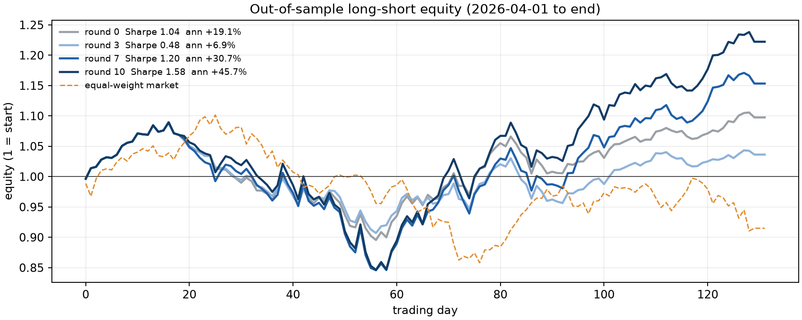
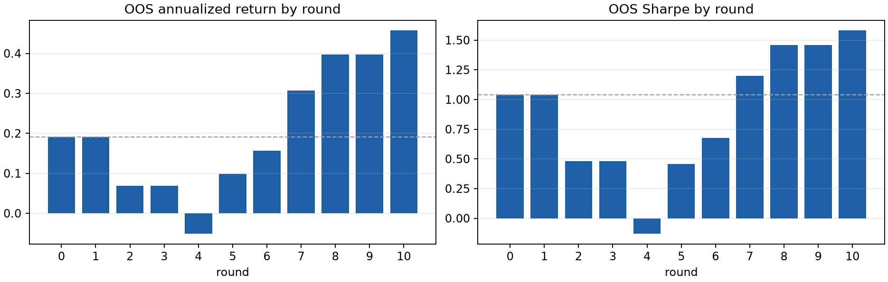

# 因子演化报告

## 池质量
| 轮次 | 池效用 | 平均 \|RankIC\| | 最优 \|RankIC\| | 子代 | 接受 | 耗时(s) |
| --- | ---: | ---: | ---: | ---: | ---: | ---: |
| 0 | 0.0833 | 0.0397 | 0.0653 | - | - | - |
| 1 | 0.0833 | 0.0397 | 0.0653 | 5 | 0 | 43.0 |
| 2 | 0.0836 | 0.0377 | 0.0653 | 5 | 1 | 45.0 |
| 3 | 0.0836 | 0.0377 | 0.0653 | 6 | 0 | 47.4 |
| 4 | 0.0926 | 0.0505 | 0.0816 | 6 | 1 | 57.9 |
| 5 | 0.1001 | 0.0557 | 0.0816 | 6 | 1 | 51.8 |
| 6 | 0.1078 | 0.0628 | 0.0816 | 6 | 1 | 57.0 |
| 7 | 0.1108 | 0.0659 | 0.0953 | 6 | 2 | 46.9 |
| 8 | 0.1111 | 0.0707 | 0.0953 | 6 | 2 | 51.8 |
| 9 | 0.1111 | 0.0707 | 0.0953 | 6 | 0 | 51.2 |
| 10 | 0.1111 | 0.0718 | 0.0967 | 6 | 1 | 49.3 |

## 样本外回测（2026-04-01 至 2026-10-16，132 个交易日，多空各 10% 等权，次日开盘调仓，双边 10bp 成本）
| 轮次 | 年化收益 | 夏普 | 最大回撤 | 组合 \|RankIC\| |
| --- | ---: | ---: | ---: | ---: |
| 0 | +19.09% | 1.04 | 17.8% | 0.0998 |
| 1 | +19.09% | 1.04 | 17.8% | 0.0998 |
| 2 | +6.92% | 0.48 | 16.7% | 0.0929 |
| 3 | +6.92% | 0.48 | 16.7% | 0.0929 |
| 4 | -5.11% | -0.13 | 25.4% | 0.1355 |
| 5 | +9.82% | 0.46 | 31.8% | 0.1807 |
| 6 | +15.70% | 0.68 | 27.6% | 0.1453 |
| 7 | +30.71% | 1.20 | 22.4% | 0.1366 |
| 8 | +39.75% | 1.46 | 22.3% | 0.1362 |
| 9 | +39.75% | 1.46 | 22.3% | 0.1362 |
| 10 | +45.74% | 1.58 | 22.3% | 0.1419 |

## 最终因子池
| 因子 | 表达式 | RankIC | cost | 节点 |
| --- | --- | ---: | ---: | ---: |
| F1 | `Div(Sub(TsEMA(vwap, 10), TsMean(vwap, 20)), Add(TsStd(close, 20), 1e-06))` | -0.0327 | 0.0128 | 28 |
| F2 | `Div(Div(TsRank(volume, 5), TsMean(num_trades, 5)), Add(TsStd(TsDelta(amt, 5), 20), 1e-06))` | +0.0967 | 0.0327 | 32 |
| F3 | `Sub(Rank(TsMean(close, 20)), Rank(close))` | +0.0574 | 0.0535 | 17 |
| F4 | `Div(TsCov(Sub(high, low), volume, 20), Add(TsStd(TsDelta(close, 5), 20), 1e-06))` | -0.0784 | 0.0099 | 30 |
| F5 | `TsCorr(TsRank(close, 5), TsRank(amt, 5), 20)` | -0.0701 | 0.0162 | 16 |
| F6 | `Div(TsCov(Sub(high, low), num_trades, 10), Add(TsMean(close, 20), 1e-06))` | -0.0953 | 0.0323 | 26 |

## 演化策略更新
- 第 1 轮：本轮窗口缩短有效：TsCorr(close,amt,20→10)提升|IC|且通过门槛；秩变换降IC。分母替换为波动率结构致相关性0.77被拒，应避免同源嵌套。下轮优先缩短滚动窗口、保留分母保护，避免秩变换与高相关结构改动。
- 第 2 轮：本轮仅WMA替换均值被接受但|IC|反降，靠池增量入池；缩短窗口对低IC父因子小幅提分却因credit不足被拒。下轮优先改分母结构而非分子平滑，避免同源嵌套与纯窗口缩短；保留分母保护，慎用秩变换。
- 第 3 轮：本轮零接受：改分母(TsMed)、缩短窗口均小幅提|IC|但credit≈0或为负，且max_corr逼近0.76门槛被拒。下轮优先改分子结构或换特征(vwap/volume)以脱同源，避免仅换分母平滑、纯缩窗；保留分母保护，控相关<0.75。
- 第 4 轮：本轮接受：分子改TsCov(Sub(high,low),close,20)显著提|IC|与credit，相关0.60安全；换vwap略降。拒绝点：同源vwap/close比值变体max_corr>0.82，仅缩窗credit≈0。下轮优先保持分母保护、改分子为价量协方差并试vwap/volume脱同源；避免纯缩窗与同源比值。
- 第 5 轮：本轮接受：分子用TsCov(Sub(high,low),close,20)提|IC|，但分母TsMed/TsMean(amt,20)致max_corr>0.92被拒；改价量比Div(volume/num_trades,amt)成功入池(IC0.066,corr0.51)。拒绝：同源比值、纯缩窗。下轮保持分母保护，分子试vwap/volume或价量协方差，避免与amt同源。
- 第 6 轮：本轮TsCov(Sub(high,low),volume,20)分子成功替换(IC0.078,corr0.37)；vwap同源协方差corr0.93被拒。分母保持TsStd(TsDelta(close,5),20)有效。下轮优先价量协方差配volume/num_trades而非vwap/amt，避免与池内amt同源；纯vwap动量与缩窗无效。
- 第 7 轮：TsRank内嵌配对(close与amt/volume,窗口5)有效提升IC；TsCov(high-low,num_trades)窗口10优于20，窗口20虽IC高但corr0.80被拒。分母替换为TsStd(TsDelta)池增量转负。下轮优先：价量协方差用num_trades配短窗10，保持原分母；避免窗口20及vwap/amt同源。
- 第 8 轮：TsRank替换外层TsMean(volume,5)提升IC至0.09且corr0.69可入池；EMA(10)替WMA(20)配vwap可入池但corr0.75边缘。避免close同源EMA(corr0.79被拒)及TsStd(TsDelta)分母。下轮优先：对分子各分量试TsRank、短窗EMA(10)替长窗均值，保持原分母，控corr<0.75。
- 第 9 轮：TsRank替内层分量可提IC但本轮增益不足，保留原式。EMA(10)替TsMean(amt,20)提IC至0.093却corr0.716且C负被拒；num_trades替volume提IC至0.092但corr0.775超限。分母窗口缩至10可降corr至0.65可入池。下轮优先短窗EMA但控corr<0.70，避免同源替换致高相关。
- 第 10 轮：分母用TsStd(TsDelta(amt,5),20)替TsMean(amt,20)有效，IC升至0.097且C正入池；同源替换num_trades或缩窗至10均C负被拒。EMA/close换vwap系列IC低且corr0.79超限。下轮优先对分母做波动率/差分结构改造并控corr<0.73，避免同源变量替换与短窗EMA。

